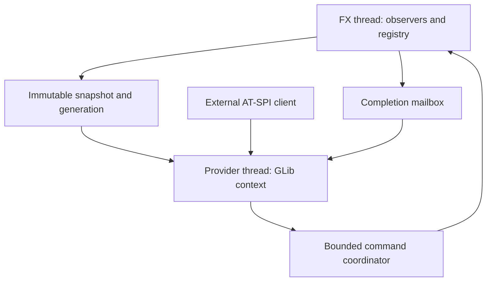

# System design

## Status and scope

Target design accepted for incremental implementation, not a claim that these components already exist. Baseline: commit `c29e8f33f816244086fab5f0c93f343326eb01e0`; Java 27 / JavaFX 27 / Linux x86_64. Current classes: `FxAtSpiBridge`, `AtSpiProvider`, `Ffm`, plus internal packages `model` (immutable records), `fx` (registry, scene reader, action executor) and `protocol` (pure AT-SPI mapping) from [issue 2](../specs/issue-2.md). Current tests cover variants, Unicode, the model, protocol mapping and the FX scene reader. Full screen-reader interoperability is not established.

Integrate an opt-in library into each JavaFX application. An independently developed third-party AT-SPI client discovers and operates it. This repository implements no MCP server, MCP tools or MCP client. No screenshots, sudo, synthetic pointer injection, HTTP server or embedded LLM are needed. Semantic action success does not prove visual appearance or completion of asynchronous business work.

## Boundaries and patterns

| Logical component | Responsibility | Pattern / ownership |
|---|---|---|
| Public facade | Install, configuration, lifecycle, diagnostics | Facade; preserve existing install/close |
| FX observers and adapters | Subscribe, read semantics, perform permitted actions | Adapter/Strategy; FX thread only |
| Model and identity registry | Immutable records, IDs, generation, ordered children | Snapshot; registry confined to FX owner |
| Policy and command coordinator | Validate admission/expiry; bounded pending work | Command + explicit state machine |
| AT-SPI transport | Export, diff, events, invoke/reply | Ports/adapters; GLib provider owner |
| Typed native bindings | ABI, layouts, ownership, callbacks | Resource wrappers; FFM boundary |

Start with logical package boundaries in one library. Do not introduce separate Gradle modules, event frameworks or a general-purpose event bus without a demonstrated need. Keep framework objects out of published snapshots; resolve opaque action targets in the FX registry. Snapshots still carry text by design, subject to redaction and bounded retention.

## Thread and event design

Perform one initial traversal. Observe windows, scenes/roots, children and exposed control properties; register/unregister subscriptions with node lifetime. Mark dirty IDs/subtrees and schedule at most one flush for a batch. Rebuild only the relevant subtree/property projection and publish a coherent generation. Ancestor visibility/disabled changes must invalidate descendants. Preserve ordered child semantics and root changes. A node inserted and removed within a batch may be coalesced; document state synchronization rather than an exhaustive transition log.

On the provider owner, reconcile generations and drain completion commands, then block in `g_main_context_iteration(context, TRUE)` or an equivalent GLib main loop. Publication, replies and stop enqueue work and wake the context. `wakeup` interrupts the wait; it does not itself run queued Java work. Use a drain/recheck protocol so no work is stranded between drain and wait. Gate wakeups against lifecycle and context lifetime; never touch a freed context. Avoid invoking Java callbacks with unexpected thread ownership through `g_main_context_invoke`.

Sources: [GLib iteration](https://docs.gtk.org/glib/method.MainContext.iteration.html), [wakeup](https://docs.gtk.org/glib/method.MainContext.wakeup.html), [invoke](https://docs.gtk.org/glib/method.MainContext.invoke.html).

## Action and modal behavior

1. Provider validates method, sender policy, payload size, ID/generation and available capacity; retains invocation once.
2. Coordinator admits a bounded command with monotonic deadline and action ID; FX scheduling never blocks either owner.
3. FX resolves the live target and revalidates privacy, visibility, enabled/editable state and modality, then calls the action outside locks.
4. FX sends immutable completion; provider answers and releases once. Business completion requires a separately observable condition.

States: QUEUED → RUNNING → COMPLETED/FAILED; QUEUED → EXPIRED/CANCELLED. A request timeout after RUNNING does not cancel application code or imply no side effect. `showAndWait()` enters a nested FX loop: keep the provider responsive, reject conflicting mutations during an active command, and permit reads of snapshots. Do not forcibly close user dialogs or interrupt handlers. Bound active operations and reserve completion/shutdown capacity so overload cannot leak native invocations.

## Lifecycle and recovery

NEW → STARTING → RUNNING → STOPPING → CLOSED, with FAILED as a terminal failure after cleanup. Close is idempotent and nonblocking on FX. Expose completion for callers outside FX; do not permit reinstall until provider termination is confirmed. Stop accepting commands, cancel unstarted work, detach listeners, drain/reply pending invocations and deregister callbacks before closing arenas. Handle bus loss with sanitized diagnostics and controlled teardown; leave the application usable. Automatic reconnect is a later explicit decision, never an endless retry loop.

## Compatibility and extensions

Preserve legacy `install()` and `install(Consumer<String>)`; add options through additive API. Keep internal AT-SPI object paths distinct from application-defined stable automation IDs; reject/report duplicates deterministically. IDs are not authorization. Adapt `AccessibleRole`, query/accessibility actions where suitable through public APIs; verify each control's semantics rather than assuming universal support. Custom adapters must define properties, supported actions, listener disposal, redaction and threading. Table/tree virtualization needs logical item identity, lazy bounded exposure and separate qualification.
